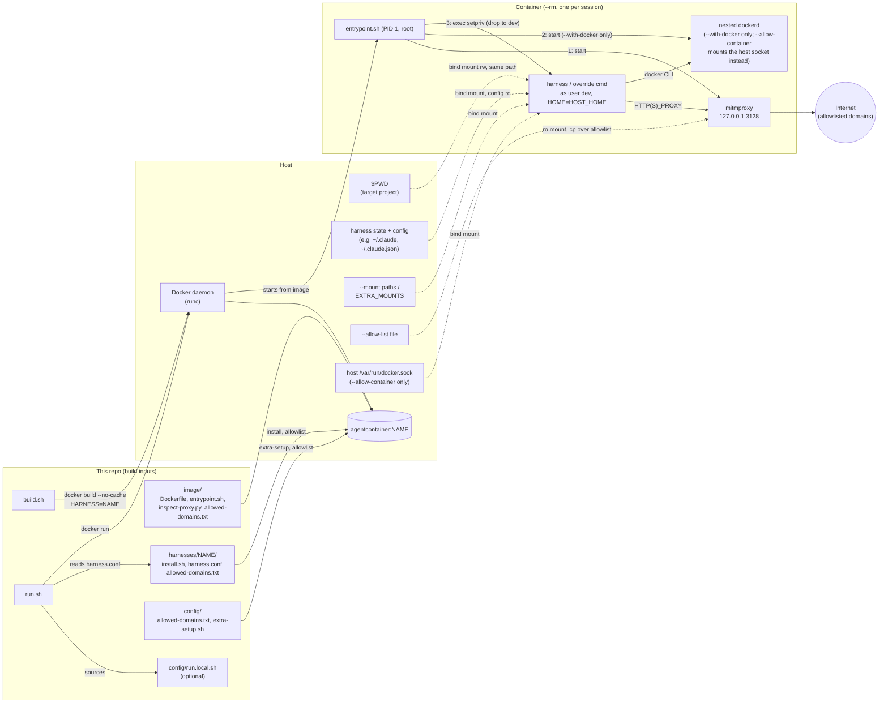

# Agent-Container

Run an AI coding agent like [Claude Code](https://docs.claude.com/en/docs/claude-code) in
full-auto mode without handing it your whole machine.

`run.sh` starts a fresh, throwaway Docker container for the project you're in. The
agent gets your project folder and its own login, nothing else from your home
directory, and only reaches the internet through a domain allowlist. When you exit,
the container is gone.

- **Scoped access:** only `$PWD`, the agent's own state (e.g. `~/.claude`),
  and any extra mounts you ask for.
- **Your config stays safe:** hooks, plugins, MCP servers and settings are mounted
  read-only, so a session can't plant something that runs on your host later.
- **Egress allowlist:** outbound HTTP(S) goes through a mitmproxy forward proxy that only
  lets through package registries, GitHub, Docker Hub and the agent's own API.
- **Docker inside:** with `--with-docker` a session gets its own nested Docker
  daemon, so `docker` and `docker compose` work without touching the host's;
  off by default.
- **Pluggable harnesses:** Claude Code, [Hermes Agent](#hermes-agent) and
  [opencode](#opencode) ship today. Each tool is a small folder under
  [`harnesses/`](harnesses/), so adding another needs no changes to the sandbox itself.

**What it isn't:** a hard security boundary. The proxy and the nftables egress
firewall guard against accidents - a tool that ignores proxy settings gets no
network at all - but they don't contain a determined escape from the container
itself. The container itself runs unprivileged by default; only an explicitly
requested nested Docker daemon ([`--with-docker`](#docker-inside-the-sandbox))
needs `--privileged` (or [sysbox](docs/sysbox.md)). The Windows scripts haven't
been tested on Windows yet.

## Requirements

- Linux with Docker. The image is based on Ubuntu 24.04.
- Or Windows 10/11 with Docker Desktop on WSL2: see [docs/windows.md](docs/windows.md),
  where `setup.ps1` installs everything and `build.ps1`/`run.ps1` replace the shell
  scripts.
- Optional: [sysbox](docs/sysbox.md), for a nested Docker daemon (`--with-docker`) with
  real isolation instead of `--privileged`.

You don't need Claude Code (or any other harness) installed on the host; it's
installed in the image.

## Quick start

```sh
git clone https://github.zhaw.ch/Security-Operations-Center/Agent-Container.git ~/Agent-Container
cd ~/Agent-Container
./build.sh                     # builds agentcontainer:claude (one image per harness)

cd ~/path/to/some-project
~/Agent-Container/run.sh --allow-config   # first run only: log in, see below
~/Agent-Container/run.sh                  # every run after that
```

Step-by-step guides with a diagram of each session:
[Claude Code](docs/quickstart-claude.md), [Hermes Agent](docs/quickstart-hermes.md),
[opencode](docs/quickstart-opencode.md).

**First run.** `run.sh` creates `~/.claude` and `~/.claude.json` if they don't exist.
Claude Code then walks you through onboarding and prints a login URL: open it in a
browser on the host and paste the code back into the terminal. `--allow-config` is
needed this once so the onboarding state in `~/.claude.json` is saved; the login token
itself (`~/.claude/.credentials.json`) is saved either way. Later config changes, such
as settings, plugins or MCP servers, need `--allow-config` again. See
[What the container can see](#what-the-container-can-see).

**Shell alias.** To start it from any directory, add this to `~/.bashrc` or `~/.zshrc`
(it works in fish too):

```sh
alias claudecli="$HOME/Agent-Container/run.sh"
```

**Check your setup.** `run.sh --help` lists every flag and what a session on this
machine would get, without starting anything:

```text
Effective config on this machine:
  Harness:        claude
  Image:          agentcontainer:claude
  Network:        bridge (default; pass --host-network to change)
  Runtime:        plain runc, unprivileged (default; pass --with-docker for a nested dockerd)
  Allowlist:      image default (allowed-domains.txt baked in at build; pass --allow-list to override)
  Docker socket:  none (default; pass --with-docker for a nested dockerd, --allow-container for the host daemon)
  Harness config: read-only (default; pass --allow-config to let the harness change it)
  dev UID:GID:    1000:1000 (your host user)
  Sink:           off (--sink <dir> or SINK_DIR in run.local.sh to record finished sessions)
  Mounts:
    /home/me/project -> /home/me/project
    /home/me/.claude -> /home/me/.claude (dev's $HOME is set to match, see README.md)
    /home/me/.claude/settings.json -> /home/me/.claude/settings.json (ro)
    /home/me/.claude.json -> copied in from a ro mount (edits discarded on exit)
    ...
```

**Something in the way?** `./doctor.py` checks the machine the way `run.sh` reads it:
does the daemon answer, is the image built and current, are the gitignored `config/`
files in place, does `config/run.local.sh` parse, do the `EXTRA_MOUNTS` sources still
exist, is the env file valid (format, reserved names, permissions), are there
allowlist entries that can never match, is `~/.claude.json` a file rather than a
directory. Each finding names the file and the command that fixes it, and it exits
non-zero only when something would actually stop a session.

```sh
~/Agent-Container/doctor.py               # the default harness (or: doctor.py hermes)
~/Agent-Container/doctor.py --all         # every harness under harnesses/
~/Agent-Container/doctor.py --fix         # also create what's missing (config files, state dirs)
```

On Windows, `python .\doctor.py` reads `run.ps1`'s files instead - see
[docs/windows.md](docs/windows.md).

### Hermes Agent

[Hermes Agent](https://github.com/NousResearch/hermes-agent) works the same way, with
its own image and its state in `~/.hermes`:

```sh
./build.sh hermes                                                      # agentcontainer:hermes
~/Agent-Container/run.sh --harness hermes --allow-config   # first run: `hermes setup` picks a provider and saves config.yaml/.env
~/Agent-Container/run.sh --harness hermes                              # every run after that
```

Set `HARNESS=hermes` in `config/run.local.sh` to make it the default. The allowlist
covers Nous Portal, OpenRouter, Anthropic and OpenAI; any other provider needs its API
domain in `config/allowed-domains.txt` (then rebuild) - for a self-hosted
OpenAI-compatible server (llama.cpp, Ollama, vLLM) include the port, e.g.
`llm.example.lan:8080`, and set `provider: custom` plus `base_url` in
`~/.hermes/config.yaml`. The image is large (about 6 GB), and the first launch for
each home prepares a dependency environment in `~/.hermes/installs` (about 670 MB),
which takes a minute. Walkthrough: [docs/quickstart-hermes.md](docs/quickstart-hermes.md).

### opencode

[opencode](https://opencode.ai) keeps its sessions and login in
`~/.local/share/opencode` and its settings in `~/.config/opencode`:

```sh
./build.sh opencode
~/Agent-Container/run.sh --harness opencode   # then /connect (or `opencode auth login`) to add a provider
```

Logins and API keys live with the session data, so they persist without
`--allow-config`; only `~/.config/opencode` (settings, MCP servers, plugins, agents,
commands) is read-only. Set `HARNESS=opencode` in `config/run.local.sh` to make it the
default. The allowlist covers opencode's own services (model catalog, Zen), Anthropic,
OpenAI, OpenRouter and GitHub Copilot; other providers need their API domain in
`config/allowed-domains.txt` (then rebuild). `~/.cache/opencode` isn't shared with the
host - it holds the LSP servers and npm packages opencode downloads and executes,
re-fetched in each session - and self-update is off: `./build.sh opencode` picks up the
latest release. Walkthrough: [docs/quickstart-opencode.md](docs/quickstart-opencode.md).

## Usage

```sh
run.sh                    # interactive harness session in $PWD (default: claude)
run.sh --continue         # args starting with `-` are forwarded to the harness
run.sh --permission-mode manual   # claude starts in auto mode by default; this overrides it
run.sh bash               # anything else replaces the harness command entirely
run.sh --help             # flags + this machine's resolved harness/mounts/network/runtime
```

`run.sh` handles the options below itself and doesn't forward them to Docker or the
harness. They can go anywhere in the argument list:

| Flag                                     | Effect (this session only)                                                                                                          |
|------------------------------------------|-------------------------------------------------------------------------------------------------------------------------------------|
| `--harness NAME`                         | Run `harnesses/NAME` (image `agentcontainer:NAME`) instead of the default (`$HARNESS`, else `claude`).                                 |
| `--mount PATH` / `--mount HOST:CTR[:ro]` | Extra bind mount. A bare path mounts read-write at the same path on both sides. Repeatable.                                         |
| `--ca-cert FILE`                         | Import a root CA file into the container's trust store (repeatable; `CA_CERTS` in `run.local.sh` = default), so internal hosts signed by a private CA are trusted. Only the container's store changes. |
| `--label KEY=VALUE`                      | Docker label on the session container (repeatable). Metadata only - lets an orchestrator such as Agent-Fleet find its sessions with `docker ps --filter label=...`. |
| `--env NAME=VALUE`                       | Set one variable in the session (repeatable). Same name rules as `--env-file`. |
| `--loopback-socket PORT:SOCKET`          | Forward `127.0.0.1:PORT` in the container to the host Unix socket `SOCKET` (repeatable; adds no egress). For tools that report to a fixed loopback port. Linux only, not with `--host-network`. |
| `-- ARGS...`                             | End of `run.sh`'s own flags: everything after it goes to the harness verbatim, positional args included (`run.sh -- "fix the bug"`). Needs an image built after this change. |
| `--allow-list FILE`                      | Replace the whole egress allowlist with `FILE` (same format as `allowed-domains.txt`).                                              |
| `--allow-internet`                       | Full internet for this session: drop the domain and port allowlists AND the nftables egress firewall (proxied traffic still logged). `ALLOW_INTERNET=1` in `run.local.sh` = default. Can't be combined with `--allow-list`. |
| `--host-network`                         | Share the host's network namespace instead of the bridge. For VPNs that block the bridge - grants access to host loopback services and skips the nftables egress firewall.      |
| `--allow-container`                      | Mount the **host's** Docker socket instead of any nested `dockerd`. Root-equivalent, see [below](#docker-inside-the-sandbox). |
| `--with-docker`                          | Run a nested `dockerd` in the container (with `--privileged`, or sysbox if installed). Off by default, see [below](#docker-inside-the-sandbox). |
| `--sysbox`                               | Implies `--with-docker` and forces the `sysbox-runc` runtime instead of `--privileged`. See [docs/sysbox.md](docs/sysbox.md). |
| `--allow-config`                         | Let the harness change its config on the host. Read-only by default, see [below](#what-the-container-can-see).                      |
| `--no-bash-sandbox`                      | Don't start the harness's `sandboxed_command` even if it has one (default where the harness defines one; for Claude Code: the [Bash sandbox](#bash-sandbox)). `--bash-sandbox` forces it on; refused if the harness defines no `sandboxed_command`. |
| `--env-file FILE`                        | Pass the variables in `FILE` (docker env file) into the session, e.g. MCP tokens. See [below](#secrets-for-mcp-servers).            |
| `--no-env-file`                          | Pass no env file, not even the default `~/.config/agentcontainer.env`.                                                              |
| `--proxy-logs[=PATH]`                    | Save this session's proxy logs (mitmdump log + JSONL flow log) to the host, in `~/.local/state/agentcontainer/logs/<timestamp>-<harness>/` (`PATH`, or `PROXY_LOG_DIR` in `run.local.sh`, changes the base dir). See [Network egress](#network-egress). |
| `--no-proxy-logs`                        | Don't save the proxy logs this session, even with `PROXY_LOGS=1` set.                                                               |
| `--inspect`                              | TLS interception: mitmproxy decrypts HTTPS with a throwaway CA trusted only in-container, logging full request/response bodies with known secret shapes redacted. Breaks TLS pinning - off by default (`INSPECT=1`). |
| `--sink DIR`                             | Record the finished session on the host as a queryable result (`record.json` + `changes.patch` per session, one line appended to `index.jsonl`), written host-side after the container exits. Off by default; `SINK_DIR` in `run.local.sh` = default. See [Recording finished sessions](#recording-finished-sessions). |

```sh
run.sh --mount ~/data --mount ~/models:/models:ro --continue
run.sh --allow-list ./extra-domains.txt
```

When stdin or stdout isn't a terminal, `run.sh` runs the container without a TTY, so
scripted clients driving the harness over pipes (`claude -p`, `opencode acp`, an SDK)
get clean stdout/stderr and stdin's EOF.

### Recording finished sessions

A session normally leaves nothing behind but its terminal output and the harness's own
state. `run.sh --sink ~/sessions` (or `SINK_DIR=` in `config/run.local.sh`) adds a
host-side record when the session ends:

```text
~/sessions/
  index.jsonl                       one line per session: id, harness, worktree,
                                    git delta, exit code, timing
  2026-11-09-141230-claude-4162/
    record.json                     git delta (commits, changed files, branch, HEAD
                                    before/after), exit code, timing, pointers to the
                                    harness state dir and the session's proxy logs
    changes.patch                   git diff of what the session changed
```

`tools/sessionlog.py` writes the record *after* the container exits, so it reflects
what the agent actually committed - never something the agent wrote about itself - and
it adds no egress. The record id is the `fleet.session` docker label when one was
passed with `--label` (how Agent-Fleet matches a record to a session), else a
timestamped id.

## Configuration

Per-machine settings live in `config/`. Each file there is gitignored and has a tracked
`.example` next to it; `build.sh` creates the first two for you on the first build.

| File | Read by | What it's for |
|---|---|---|
| `config/allowed-domains.txt` | `build.sh` | Extra domains to allow, on top of the defaults. See [Network egress](#network-egress). |
| `config/extra-setup.sh` | `build.sh` | Extra packages or tools baked into the image. See [Customizing the image](#customizing-the-image). |
| `config/run.local.sh` | `run.sh` | Default harness (`HARNESS=`), standing mounts (`EXTRA_MOUNTS`), extra read-only paths (`EXTRA_CONFIG_RO_PATHS`), extra root CAs (`CA_CERTS`), UID override (`CONTAINER_UID`), nested Docker by default (`WITH_DOCKER=1`), Bash sandbox off (`BASH_SANDBOX=0`), env file (`ENV_FILE=`), proxy logs to the host (`PROXY_LOGS=1`, `PROXY_LOG_DIR=`), TLS interception (`INSPECT=1`), full internet (`ALLOW_INTERNET=1`), session sink dir (`SINK_DIR=`). |
| `config/run.local.ps1` | `run.ps1` | The same for Windows. |

**Rebuild with `./build.sh` after changing anything in `image/`, `harnesses/`,
`config/allowed-domains.txt` or `config/extra-setup.sh`** - they're baked into the
image, and a stale image keeps running the old version without any warning. `build.sh`
builds with `--no-cache` by default, so every build picks up current packages and the
latest harness release; `./build.sh claude` builds just one harness, no arguments
builds all of them, and `./build.sh --cached` reuses Docker's layer cache - much faster
when you only changed this repo's own files, but nothing already cached gets updated.

## How it works



- **Build time:** `build.sh` builds one image per harness from `image/Dockerfile`. The
  shared part copies in `entrypoint.sh` and `inspect-proxy.py` and runs
  `config/extra-setup.sh`. The harness part runs `harnesses/NAME/install.sh`, bakes in
  its `harness.conf`, and assembles the allowlist.
- **Run time:** `run.sh` reads `harnesses/NAME/harness.conf` and starts a fresh `--rm`
  container with only the mounts listed below.
- **Inside the container:** `entrypoint.sh` runs as root: it starts mitmdump (the egress
  proxy, as its own unprivileged `agentproxy` user) and, with `--with-docker`, the
  nested `dockerd`; then drops to the unprivileged `dev` user (no sudo) to run the
  harness's default command or the command you gave.

### Repository layout

| Path | What's in it |
|---|---|
| `build.sh`, `run.sh` | What you run: build the images, start a session. |
| `doctor.py` | Setup check: is this machine ready for a session, and what to fix if not. |
| `build.ps1`, `run.ps1`, `setup.ps1` | The same for Windows, see [docs/windows.md](docs/windows.md). |
| [`harnesses/`](harnesses/) | One folder per supported tool: how to install it, what to mount, which domains it needs. See [harnesses/README.md](harnesses/README.md). |
| [`tools/`](tools/) | Host-side helpers, not baked into the image: `flowlog.py` analyzes the `--proxy-logs` session logs; `flowaudit.py` has a headless sandbox session do a prompted security analysis of them (see [Auditing the flow logs](#auditing-the-flow-logs)); `sessionlog.py` writes the `--sink` record of a finished session (see [Recording finished sessions](#recording-finished-sessions)). |
| `image/` | The shared sandbox: `Dockerfile`, `entrypoint.sh`, the mitmproxy egress addon and the default allowlist. Nothing harness-specific. |
| `config/` | Your per-machine settings, see [Configuration](#configuration). |
| `lib/` | Helpers for the PowerShell scripts. |
| `docs/` | Per-harness quickstarts, Windows and sysbox setup, and the deep dives linked below. |

## What the container can see

| Host path                               | Container path        | Why                                                                   |
|-----------------------------------------|-----------------------|-----------------------------------------------------------------------|
| `$PWD`                                  | same path, read-write | Your project. Git and absolute paths behave as on the host.           |
| Harness state, e.g. `~/.claude`         | same path, config ro  | Reuses the harness's login, settings, plugins and MCP config.         |
| Staged files, e.g. `~/.claude.json`     | copied in             | Rewritten by the harness on every start, see below.                   |
| `EXTRA_MOUNTS` in `config/run.local.sh` | as configured         | Standing mounts for this machine.                                     |
| `--mount` arguments                     | as given              | One-off mounts for a single session.                                  |

Which harness paths are mounted, and how, comes from its `harness.conf` - see
[harnesses/README.md](harnesses/README.md). When `$PWD` is a `git worktree` (its `.git`
is a file), the main repo's git dir is mounted read-write at its own path too, so git
works inside the container; a worktree session can then change the main repo's refs
and `.git` - the same exposure a plain repo's `$PWD/.git` has - while the main working
tree stays unmounted.

Inside the container you're the user `dev`, but with your host UID and GID: `run.sh`
passes them in and `entrypoint.sh` remaps `dev` at startup, so files created in mounted
directories stay owned by you on the host. (The remap is skipped under root, rootless
Docker and Podman, which already map correctly; override with `CONTAINER_UID` /
`CONTAINER_GID` in `config/run.local.sh` or the environment, `CONTAINER_UID=off` keeps
`dev` at 1000:1000.) The harness's files are mounted at your host's `$HOME` path, not
`/home/dev`, and `dev`'s `$HOME` is set to match - Claude Code records absolute plugin
paths based on `$HOME`, so a mismatch would break host-installed plugins with
`cache-miss`.

By default the container can't change the harness's **configuration**: for Claude Code,
hooks in `settings.json`, MCP servers in `~/.claude.json`, plugins, agents, commands
and skills all run with full access on the host the next time you use `claude`
natively, so a session that edits them could escape the sandbox. `~/.claude` stays
read-write (Claude Code needs it for transcripts, history and login token refreshes),
with `settings.json`, `settings.local.json`, `CLAUDE.md`, `keybindings.json`, `agents/`,
`commands/`, `skills/`, `hooks/`, `plugins/` and `output-styles/` mounted read-only on
top of it. `~/.claude.json` is copied in instead, because Claude Code rewrites it on
every start - so changing settings or installing plugins fails in-session, and trust
prompts reset every session. Pass `--allow-config` to mount all of it read-write; if
your settings point at other files (e.g. a statusline script), add them with
`EXTRA_CONFIG_RO_PATHS+=(.claude/statusline.sh)` in `config/run.local.sh`.

For mounts you need in every session on this machine, copy
`config/run.local.sh.example` to `config/run.local.sh` (gitignored) and fill in
`EXTRA_MOUNTS`. Each extra mount widens the sandbox, so add them deliberately.

## Network egress

All outbound HTTP (S) goes through a mitmproxy forward proxy inside the container,
listening only on `127.0.0.1:3128`. The proxy only lets through the domains in the image's
allowlist, which `build.sh` assembles from three files:

- `image/allowed-domains.txt`: shared defaults (package registries, GitHub, Docker Hub)
- `harnesses/NAME/allowed-domains.txt`: what the harness itself needs
- `config/allowed-domains.txt`: your own additions (gitignored)

One domain per line; a leading `.` also matches subdomains. Bare IPv4/IPv6 addresses and
CIDRs work too (`10.10.10.81`, `fd00::/64`) - a tool pointed straight at an IP can't be matched by
domain; an IPv6 entry with a port needs brackets: `[fd00::10]:8080`. Only ports 80 and 443 are
allowed, unless an entry names another one: `llm.example.lan:8080` (for example a
self-hosted model server) also opens port 8080, for every allowed domain. Add to your
own file (and rebuild) for a permanent change; for a single session use
`--allow-list FILE` (replaces the whole list) or `--allow-internet`, which need no
rebuild.

`entrypoint.sh` sets the proxy in the environment (upper- and lowercase), in apt's
config and in git's config. **This is enforced, not just advisory.** `entrypoint.sh`
also installs an nftables egress firewall: everything except loopback, the Docker
bridges and replies to allowed flows is rejected for the `dev` user, so a tool that
ignores proxy settings (`curl --noproxy`, raw sockets) or tries outbound port 22 (no
git-over-SSH: pushing stays a host-side operation) simply can't reach the network.
Only the proxy's `agentproxy` user and root (a `--with-docker` nested daemon) originate
traffic directly; `run.sh` adds `--cap-add NET_ADMIN`, scoped to the container's own
network namespace. The firewall is skipped by `--allow-internet` (unrestricted egress is
its point) and by `--host-network` (the rules would land in the host's ruleset).
Traffic from *nested* containers (with `--with-docker`) goes through the nested daemon,
not this allowlist. For Claude Code, the [Bash sandbox](#bash-sandbox) (on by default)
adds the harness's own network/filesystem restrictions on top.

Every proxied flow - allowed and blocked - is logged inside the container: mitmdump's
log at `/tmp/mitmdump.log` (read it with `tail` when something fails to download) and
the addon's JSONL flow log at `/tmp/agentcontainer/flows.jsonl`. Those logs die with
the container; `run.sh --proxy-logs` (or `PROXY_LOGS=1`) mirrors both into a per-session
host directory (`~/.local/state/agentcontainer/logs/<timestamp>-<harness>/` on Linux,
`%LOCALAPPDATA%\agentcontainer\logs\...` on Windows) for later analysis. They cover proxied traffic only - not nested containers' egress. By default
HTTPS is only tunneled, so the flow log records the target host per CONNECT; with
`--inspect` it records full request/response detail including bodies. Secrets are
redacted before anything is written (`image/redact_secrets.py`: field names plus ~30
token shapes ported from gitleaks/betterleaks) - best effort, so treat `--inspect`
logs as sensitive anyway.

`--host-network` swaps isolation for connectivity, for example behind a corporate VPN
that only routes the host's own traffic: the container then reaches every service on
the *host's* 127.0.0.1 and the nftables firewall is not installed. `run.sh` warns
loudly when you pass it.

### Auditing the flow logs

`tools/flowaudit.py` turns those logs into a scheduled security review with a model: it
starts one headless sandbox session with the logs and `tools/flowlog.py` mounted
read-only, and the agent writes a report ending in `VERDICT:
clean|suspicious|malicious` - exit 0/1/2 for clean/findings/run failed, so a cron
entry or systemd timer alerts exactly when it should. `flowaudit suggest` aggregates
allowlist denials and produces a mergeable `suggested-allowed-domains.txt` you review
before rebuilding.

```sh
tools/flowaudit.py list        # which sessions exist, which were audited
tools/flowaudit.py --dry-run   # build the digest, start no container
tools/flowaudit.py             # audit everything not audited yet
```

Setup, prompt templates, provider keys, batching and exit codes:
[docs/flow-audit.md](docs/flow-audit.md).

## Bash sandbox

By default a session starts the harness's `sandboxed_command` from `harness.conf`
instead of its `command`, whenever the harness defines one; `run.sh --no-bash-sandbox`
(or `BASH_SANDBOX=0` in `config/run.local.sh`) switches back to the plain `command`.
Only Claude Code has one so far: `claude-sandboxed`, which turns on Claude Code's own
[sandbox](https://docs.claude.com/en/docs/claude-code/sandboxing) for the shell commands
it runs. Every Bash command then runs in bubblewrap, inside the container:

- **Network:** each command gets its own network namespace. The only way out is Claude
  Code's proxy, which allows the same domains as the egress allowlist (so
  `--allow-list` applies too). Anything else waits for your OK or is refused, depending
  on the permission mode; a tool that ignores proxy settings has no network at all.
- **Secrets:** the login token (`~/.claude/.credentials.json`) and the
  `~/.claude.json` backups can't be read by shell commands or Claude Code's file tools;
  `--env-file` variables are stripped from shell commands' environment.
- **Files:** shell commands can write only in the project directory, temp dirs, and the
  read-write `--mount`/`EXTRA_MOUNTS` paths of this session.
- **Docker:** with `--allow-container` or `--with-docker`, shell commands can use the
  Docker socket; without either flag the socket paths are denied and Unix sockets
  blocked.
- **No way around it:** `allowUnsandboxedCommands` is off, so Claude can't rerun a
  failing command outside the sandbox, and there's no `sudo` in the container at all.

Claude Code itself and the MCP servers it starts aren't sandboxed by this: they still
read their config and tokens normally. The settings are generated at startup and passed
with `--settings`, so your host config never changes, and if bubblewrap doesn't work
`claude-sandboxed` refuses to start rather than run unsandboxed. What it costs: tools
that need raw network access (`nmap`, `ping`) don't work in sandboxed commands, and
every new domain needs your OK or an allowlist entry.

Under `--sysbox` the sandbox runs in a nested mode with different `/proc` and socket
behavior and one known `/proc/<pid>/environ` leak - details in
[docs/bash-sandbox.md](docs/bash-sandbox.md).

### Secrets for MCP servers

MCP servers configured in `~/.claude.json` often carry tokens in plaintext there, and
the file is copied into every session. Claude Code expands `${VAR}` in MCP server
config, so the tokens can live in an env file instead:

```json
"headers": { "Authorization": "Bearer ${ELASTIC_TOKEN}" }
```

```sh
# ~/.config/agentcontainer.env (chmod 600), docker env file format - picked up automatically
ELASTIC_TOKEN=...
JIRA_PERSONAL_TOKEN=...
```

`run.sh --env-file FILE` and `--no-env-file` (or `ENV_FILE=` in `config/run.local.sh`,
`ENV_FILE=off` for never) pick a different file or none; `run.sh` warns if the file is
world-readable or lies inside the mounted project. The variables reach Claude Code and
the MCP servers it starts, but not shell commands under the Bash sandbox (the default),
and names the sandbox itself relies on (`HTTP_PROXY` and friends, `HOME`, `HOST_*`,
`LD_*`, `OPENSSL_*`, ...) are refused, so an env file can't quietly widen the sandbox.

Which fields expand, and one-off MCP servers loaded for a single session with
`--mcp-config`: [docs/mcp-and-secrets.md](docs/mcp-and-secrets.md).

## Docker inside the sandbox

By default there is no Docker at all inside the container: no daemon, no socket, and no
`--privileged` - the `docker` CLI is inert. `run.sh --with-docker` starts a nested
`dockerd`, so `docker` and `docker compose` work; everything they create stays inside the
sandbox and is deleted when the container exits, and the host's daemon isn't reachable.
Nested `dockerd` needs heavy privileges: `run.sh` uses the `sysbox-runc` runtime when
this host has it registered (real user-namespace isolation, see
[docs/sysbox.md](docs/sysbox.md)), and `--privileged` otherwise; `--sysbox` forces the
sysbox runtime and fails if it isn't installed.

`--allow-container` instead mounts the **host's** `/var/run/docker.sock` (no nested
daemon, no `--privileged`). Containers you start then run on the host daemon as siblings
of the sandbox, and they outlive it. **This is root-equivalent access to the host**:
`docker run -v /:/host ...` is enough to get a root shell there. Only use it when you
trust everything running inside. It can't be combined with `--with-docker`/`--sysbox`.

With the [Bash sandbox](#bash-sandbox) on, either flag also lets sandboxed shell
commands use the socket - otherwise `docker` would be unusable in exactly the sessions
that asked for it.

## Customizing the image

**Another harness.** Add a directory under `harnesses/` - see
[harnesses/README.md](harnesses/README.md).

**Extra dependencies.** Use `config/extra-setup.sh` for anything a custom MCP server or
tool needs that the base image lacks. The base image ships Node 22, Python 3.14,
`uv`/`uvx`, `bun`, `gh`, `ripgrep`, `jq` and `fzf`. Copy
`config/extra-setup.sh.example` to `config/extra-setup.sh` (gitignored) and edit it. The
build runs it as root after the rest of the toolchain is installed, in every harness's
image. If the file is missing, `build.sh` creates a no-op copy.

```sh
# in config/extra-setup.sh:
apt-get update && apt-get install -y --no-install-recommends ffmpeg && rm -rf /var/lib/apt/lists/*
npm install -g some-mcp-server-package
UV_TOOL_DIR=/usr/local/share/uv-tools UV_TOOL_BIN_DIR=/usr/local/bin uv tool install some-python-mcp-server
```

Install binaries into `/usr/local/bin` rather than a home directory, because the switch
to `dev` resets `PATH`. For `uv tool`, also move its tool directory as above:
uv's default is under `/root`, which `dev` can't read. If the tool needs network access
at runtime, add its domains to `config/allowed-domains.txt` too.

MCP server *configuration* needs nothing here. The harness's config (e.g.
`~/.claude.json`) is mounted in from the host, so servers you've registered there work
as long as the command they run exists in the image. For a server you only need in
some sessions - e.g. one with broader credentials - keep it out of `~/.claude.json` and
load it per session with Claude Code's `--mcp-config` from a `chmod 600` file mounted
read-only: [docs/mcp-and-secrets.md](docs/mcp-and-secrets.md).

**Python.** Python 3.14 (from the deadsnakes PPA) is the default `python3`/`python`.
Each zsh session looks for `.venv/bin/activate` in the current directory and its
parents, and activates the first one it finds. Nothing creates the venv for you: run
`python3.14 -m venv .venv` in the project.

## Troubleshooting

- **Where do I even start?** `./doctor.py` reads the same config `run.sh` reads and asks
  docker what it knows, then lists what would stop a session and what's only worth
  fixing, each with the command that fixes it. `--fix` creates what's missing.
- **`env: 'remote-control': No such file or directory`** (or similar): a harness flag was passed
  without its leading dashes. `run.sh remote-control` is treated as a command to run
  instead of the harness. Use `run.sh --remote-control`.
- **`~/.claude.json` is a directory:** an older version of `run.sh` ran before that
  file existed, so Docker created it as root. Repair with
  `sudo rmdir ~/.claude.json; sudo chown -R "$USER": ~/.claude`, then follow
  the first-run steps in [Quick start](#quick-start).
- **`image agentcontainer:NAME not found`:** run `./build.sh NAME`.
- **A change to the image has no effect:** rebuild with `./build.sh`.
- **A download or API call is blocked:** run `tail /tmp/mitmdump.log` inside
  the container to see which domain was refused, then use `--allow-list` or add it to
  `config/allowed-domains.txt`. Start with `--proxy-logs` (or `PROXY_LOGS=1` in
  `config/run.local.sh`) to keep the logs on the host after the session ends.
- **`cache-miss` on `/reload-plugins`:** make sure you started through `run.sh`, which
  keeps `$HOME` in the container the same as on the host. A bare `docker run` doesn't.

## Contributing

Issues and pull requests are welcome at
[github.zhaw.ch/Security-Operations-Center/Agent-Container](https://github.zhaw.ch/Security-Operations-Center/Agent-Container). There's
no test suite: to check a change, rebuild with `./build.sh` and start a session with
`run.sh bash`. Record user-visible changes under `## Unreleased` in
[CHANGELOG.md](CHANGELOG.md). If you change a `run.sh` flag or a mounted path, make the
same change in `run.ps1`.

## License

No license file is included - all rights reserved by default. Open an issue if you'd
like to use this under different terms.
