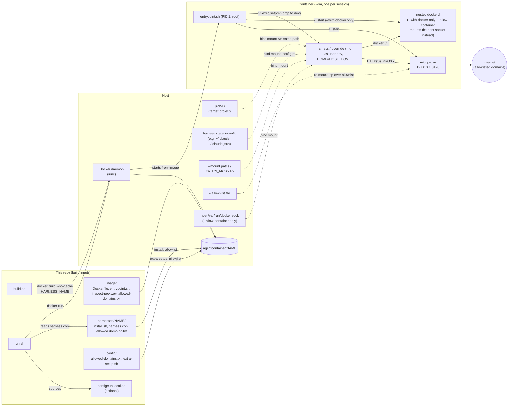

# Agent-Container

Run an AI coding agent like [Claude Code](https://docs.claude.com/en/docs/claude-code) in
full-auto mode without handing it your whole machine.

`run.sh` starts a fresh, throwaway Docker container for the project you're in. The
agent gets your project folder and its own login, nothing else from your home
directory, and only reaches the internet through a domain allowlist. When you exit,
the container is gone.

- **Scoped access:** only `$PWD`, the agent's own state (e.g. `~/.claude`),
  and any extra mounts you ask for.
- **Your config stays safe:** hooks, plugins, MCP servers and settings are mounted
  read-only, so a session can't plant something that runs on your host later.
- **Egress allowlist:** outbound HTTP(S) goes through a mitmproxy forward proxy that only
  lets through package registries, GitHub, Docker Hub and the agent's own API.
- **Docker inside:** each session has its own nested Docker daemon, so `docker` and
  `docker compose` work without touching the host's.
- **Pluggable harnesses:** Claude Code, [Hermes Agent](#hermes-agent) and
  [opencode](#opencode) ship today. Each tool is a small folder under
  [`harnesses/`](harnesses/), so adding another needs no changes to the sandbox itself.

**What it isn't:** a hard security boundary. The proxy guards against accidents, but
a tool that ignores proxy settings can still reach the network. The container itself runs
unprivileged by default; only an explicitly requested nested Docker daemon
([`--with-docker`](#docker-inside-the-sandbox)) needs `--privileged` (or
[sysbox](docs/sysbox.md)). The Windows scripts haven't been tested on Windows yet.

## Requirements

- Linux with Docker. The image is based on Ubuntu 24.04.
- Or Windows 10/11 with Docker Desktop on WSL2: see [docs/windows.md](docs/windows.md),
  where `setup.ps1` installs everything and `build.ps1`/`run.ps1` replace the shell
  scripts.
- Optional: [sysbox](docs/sysbox.md), for a nested Docker daemon (`--with-docker`) with
  real isolation instead of `--privileged`.

You don't need Claude Code (or any other harness) installed on the host; it's
installed in the image.

## Quick start

```sh
git clone https://github.zhaw.ch/Security-Operations-Center/Agent-Container.git ~/Agent-Container
cd ~/Agent-Container
./build.sh                     # builds agentcontainer:claude (one image per harness)

cd ~/path/to/some-project
~/Agent-Container/run.sh --allow-config   # first run only: log in, see below
~/Agent-Container/run.sh                  # every run after that
```

Step-by-step guides with a diagram of each session:
[Claude Code](docs/quickstart-claude.md), [Hermes Agent](docs/quickstart-hermes.md),
[opencode](docs/quickstart-opencode.md).

**First run.** `run.sh` creates `~/.claude` and `~/.claude.json` if they don't exist.
Claude Code then walks you through onboarding and prints a login URL: open it in a
browser on the host and paste the code back into the terminal. `--allow-config` is
needed this once so the onboarding state in `~/.claude.json` is saved; the login token
itself (`~/.claude/.credentials.json`) is saved either way. Later config changes, such
as settings, plugins or MCP servers, need `--allow-config` again. See
[What the container can see](#what-the-container-can-see).

**Shell alias.** To start it from any directory, add this to `~/.bashrc` or `~/.zshrc`
(it works in fish too):

```sh
alias claudecli="$HOME/Agent-Container/run.sh"
```

**Check your setup.** `run.sh --help` lists every flag and what a session on this
machine would get, without starting anything:

```text
Effective config on this machine:
  Harness:        claude
  Image:          agentcontainer:claude
  Network:        bridge (default; pass --host-network to change)
  Runtime:        plain runc, unprivileged (default; pass --with-docker for a nested dockerd)
  Allowlist:      image default (allowed-domains.txt baked in at build; pass --allow-list to override)
  Docker socket:  none (default; pass --with-docker for a nested dockerd, --allow-container for the host daemon)
  Harness config: read-only (default; pass --allow-config to let the harness change it)
  dev UID:GID:    1000:1000 (your host user)
  Mounts:
    /home/me/project -> /home/me/project
    /home/me/.claude -> /home/me/.claude (dev's $HOME is set to match, see README.md)
    /home/me/.claude/settings.json -> /home/me/.claude/settings.json (ro)
    /home/me/.claude.json -> copied in from a ro mount (edits discarded on exit)
    ...
```

**Something in the way?** `./doctor.py` checks the machine the way `run.sh` reads it (on
Windows, `python .\doctor.py` reads `run.ps1`'s files instead - see
[docs/windows.md](docs/windows.md)): does the daemon answer, is the image built and
current, are the gitignored `config/` files in place, does `config/run.local.sh` parse,
is the env file in the format docker wants, is `~/.claude.json` a file rather than a
directory. Each finding names the file and the command that fixes it, and it exits
non-zero only when something would actually stop a session.

```sh
~/Agent-Container/doctor.py               # the default harness (or: doctor.py hermes)
~/Agent-Container/doctor.py --all         # every harness under harnesses/
~/Agent-Container/doctor.py --fix         # also create what's missing (config files, state dirs)
```

### Hermes Agent

[Hermes Agent](https://github.com/NousResearch/hermes-agent) works the same way, with
its own image and its state in `~/.hermes`:

```sh
./build.sh hermes                                # agentcontainer:hermes
~/Agent-Container/run.sh --harness hermes --allow-config   # first run: pick a model and log in
~/Agent-Container/run.sh --harness hermes                  # every run after that
```

On the first run, `hermes setup` (or `hermes model`) inside the session walks you
through choosing a provider; `--allow-config` lets it save `config.yaml` and `.env`.
Set `HARNESS=hermes` in `config/run.local.sh` to make it the default. See
[docs/quickstart-hermes.md](docs/quickstart-hermes.md) for a walkthrough.

- The allowlist covers Nous Portal, OpenRouter, Anthropic and OpenAI. Any other
  provider needs its API domain in `config/allowed-domains.txt` (then rebuild); for a
  self-hosted OpenAI-compatible server (llama.cpp, Ollama, vLLM) include the port,
  e.g. `llm.example.lan:8080`, and set `provider: custom` plus `base_url` in
  `~/.hermes/config.yaml`.
- The image is large (about 6 GB), since Hermes brings its own Python, Node and UI
  builds. The first launch for each home also prepares a dependency environment in
  `~/.hermes/installs` (about 670 MB), which takes a minute.

### opencode

[opencode](https://opencode.ai) keeps its sessions and login in
`~/.local/share/opencode` and its settings in `~/.config/opencode`:

```sh
./build.sh opencode                                # agentcontainer:opencode
~/Agent-Container/run.sh --harness opencode           # then /connect (or `opencode auth login`) to add a provider
```

Logins and API keys live with the session data, so they persist without
`--allow-config`; only `~/.config/opencode` (settings, MCP servers, plugins, agents,
commands) is read-only. Set `HARNESS=opencode` in `config/run.local.sh` to make it the
default. See [docs/quickstart-opencode.md](docs/quickstart-opencode.md) for a walkthrough.

- The allowlist covers opencode's own services (model catalog, Zen), Anthropic, OpenAI,
  OpenRouter and GitHub Copilot. Other providers need their API domain in
  `config/allowed-domains.txt` (then rebuild).
- `~/.cache/opencode` isn't shared with the host: it holds the LSP servers and npm
  packages opencode downloads and executes. They're fetched again in each session.
- Self-update is off inside the container; `./build.sh opencode` picks up the latest
  release.

## Usage

```sh
run.sh                    # interactive harness session in $PWD (default: claude)
run.sh --continue         # args starting with `-` are forwarded to the harness
run.sh --permission-mode manual   # claude starts in auto mode by default; this overrides it
run.sh bash               # anything else replaces the harness command entirely
run.sh --help             # flags + this machine's resolved harness/mounts/network/runtime
```

`run.sh` handles the options below itself and doesn't forward them to Docker or the
harness. They can go anywhere in the argument list:

| Flag                                     | Effect (this session only)                                                                                                          |
|------------------------------------------|-------------------------------------------------------------------------------------------------------------------------------------|
| `--harness NAME`                         | Run `harnesses/NAME` (image `agentcontainer:NAME`) instead of the default (`$HARNESS`, else `claude`).                                 |
| `--mount PATH` / `--mount HOST:CTR[:ro]` | Extra bind mount. A bare path mounts read-write at the same path on both sides. Repeatable.                                         |
| `--ca-cert FILE`                         | Import a root CA file into the container's trust store for this session (repeatable; `CA_CERTS` in `run.local.sh` = default). So an internal host signed by a private root CA is trusted - by the in-container clients, and under `--inspect` by mitmproxy's upstream check. Only the container's store changes. |
| `--label KEY=VALUE`                      | Docker label on the session container (repeatable). Metadata only, no effect on the sandbox - lets an orchestrator such as Agent-Fleet find its sessions with `docker ps --filter label=...`. |
| `--env NAME=VALUE`                       | Set one variable in the session (repeatable). Same name rules as `--env-file`. |
| `--loopback-socket PORT:SOCKET`          | Make `127.0.0.1:PORT` in the container a forward to the host Unix socket `SOCKET` (repeatable). For tools that report to a fixed loopback port (Agent-Fleet: Orca's status hooks); adds no egress. Linux only, not with `--host-network`. |
| `-- ARGS...`                             | End of `run.sh`'s own flags: everything after it goes to the harness verbatim, including positional args (`run.sh -- "fix the bug"`) and args that look like `run.sh` flags. Needs an image built after this change. |
| `--allow-list FILE`                      | Replace the whole egress allowlist with `FILE` (same format as `allowed-domains.txt`).                                              |
| `--allow-internet`                       | Full internet for this session: drop the domain and port allowlists AND the nftables egress firewall (any host, any port; proxied traffic still logged). `ALLOW_INTERNET=1` in `run.local.sh` = default. Can't be combined with `--allow-list`. |
| `--host-network`                         | Share the host's network namespace instead of the bridge network. For VPNs that block the bridge - grants access to host loopback services and skips the nftables egress firewall.      |
| `--allow-container`                      | Mount the **host's** Docker socket instead of any nested `dockerd`. Root-equivalent, see [below](#docker-inside-the-sandbox). |
| `--with-docker`                          | Run a nested `dockerd` in the container (with `--privileged`, or sysbox if installed). Off by default, see [below](#docker-inside-the-sandbox). |
| `--sysbox`                               | Implies `--with-docker` and forces the `sysbox-runc` runtime instead of `--privileged`. See [docs/sysbox.md](docs/sysbox.md). |
| `--allow-config`                         | Let the harness change its config on the host. Read-only by default, see [below](#what-the-container-can-see).                      |
| `--no-bash-sandbox`                      | Don't start the harness's `sandboxed_command` even if it has one. It's the default for harnesses that define one; for Claude Code: its own Bash sandbox on top of the container, see [below](#bash-sandbox). |
| `--env-file FILE`                        | Pass the variables in `FILE` (docker env file) into the session, e.g. MCP tokens. See [below](#secrets-for-mcp-servers).            |
| `--no-env-file`                          | Pass no env file, not even the default `~/.config/agentcontainer.env`.                                                              |
| `--proxy-logs[=PATH]`                    | Save this session's proxy logs (mitmdump log + JSONL flow log) to the host, in `~/.local/state/agentcontainer/logs/<timestamp>-<harness>/` (`PATH`, or `PROXY_LOG_DIR` in `run.local.sh`, changes the base dir). See [Network egress](#network-egress). |
| `--no-proxy-logs`                        | Don't save the proxy logs this session, even with `PROXY_LOGS=1` set.                                                               |
| `--inspect`                              | TLS interception (mitmproxy decrypts HTTPS with a throwaway CA trusted only in-container): logs full request/response detail incl. bodies, with known secret shapes redacted. Breaks TLS pinning - off by default (`INSPECT=1`). |

```sh
run.sh --mount ~/data --mount ~/models:/models:ro --continue
run.sh --allow-list ./extra-domains.txt
```

## Configuration

Per-machine settings live in `config/`. Each file there is gitignored and has a tracked
`.example` next to it; `build.sh` creates the first two for you on the first build.

| File | Read by | What it's for |
|---|---|---|
| `config/allowed-domains.txt` | `build.sh` | Extra domains to allow, on top of the defaults. See [Network egress](#network-egress). |
| `config/extra-setup.sh` | `build.sh` | Extra packages or tools baked into the image. See [Customizing the image](#customizing-the-image). |
| `config/run.local.sh` | `run.sh` | Default harness (`HARNESS=`), standing mounts (`EXTRA_MOUNTS`), extra read-only paths (`EXTRA_CONFIG_RO_PATHS`), UID override (`CONTAINER_UID`), nested Docker by default (`WITH_DOCKER=1`), Bash sandbox off (`BASH_SANDBOX=0`), env file (`ENV_FILE=`), proxy logs to the host (`PROXY_LOGS=1`, `PROXY_LOG_DIR=`), TLS interception (`INSPECT=1`), full internet (`ALLOW_INTERNET=1`). |
| `config/run.local.ps1` | `run.ps1` | The same for Windows. |

**Rebuild with `./build.sh` after changing anything in `image/`, `harnesses/`,
`config/allowed-domains.txt` or `config/extra-setup.sh`.** All of them are baked into
the image, and a stale image keeps running the old version without any warning.
`build.sh` builds with `--no-cache` by default, so every build picks up current packages
and the latest harness release, and prunes the dangling images it leaves behind.
`./build.sh claude` builds just one harness; with no arguments it builds all of them.
`./build.sh --cached` reuses Docker's layer cache instead: much faster when you only
changed this repo's own files (the entrypoint, the proxy addon and the allowlists are
copied in last), but nothing already cached gets updated - run a plain build now and
then.

## How it works



- **Build time:** `build.sh` builds one image per harness from `image/Dockerfile`. The
  shared part copies in `entrypoint.sh` and `inspect-proxy.py` and runs
  `config/extra-setup.sh`. The harness part runs `harnesses/NAME/install.sh`, bakes in
  its `harness.conf`, and assembles the allowlist.
- **Run time:** `run.sh` reads `harnesses/NAME/harness.conf` and starts a fresh `--rm`
  container with only the mounts listed below.
- **Inside the container:** `entrypoint.sh` runs as root. It starts mitmdump (the egress
  proxy, as its own unprivileged `agentproxy` user with a clean environment) and, only when `--with-docker` was passed, the nested `dockerd`; then switches
  to the unprivileged `dev` user (no sudo) to run the harness's default command or the
  command you gave.

### Repository layout

| Path | What's in it |
|---|---|
| `build.sh`, `run.sh` | What you run: build the images, start a session. |
| `doctor.py` | Setup check: is this machine ready for a session, and what to fix if not. |
| `build.ps1`, `run.ps1`, `setup.ps1` | The same for Windows, see [docs/windows.md](docs/windows.md). |
| [`harnesses/`](harnesses/) | One folder per supported tool: how to install it, what to mount, which domains it needs. See [harnesses/README.md](harnesses/README.md). |
| [`tools/`](tools/) | Host-side helpers, not baked into the image: `flowlog.py` analyzes the `--proxy-logs` session logs; `flowaudit.py` has a headless sandbox session do a prompted security analysis of them (see [Auditing the flow logs](#auditing-the-flow-logs)). |
| `image/` | The shared sandbox: `Dockerfile`, `entrypoint.sh`, the mitmproxy egress addon and the default allowlist. Nothing harness-specific. |
| `config/` | Your per-machine settings, see [Configuration](#configuration). |
| `lib/` | Helpers for the PowerShell scripts. |
| `docs/` | Per-harness quickstarts, Windows and sysbox setup. |

## What the container can see

| Host path                               | Container path        | Why                                                                   |
|-----------------------------------------|-----------------------|-----------------------------------------------------------------------|
| `$PWD`                                  | same path, read-write | Your project. Git and absolute paths behave as on the host.           |
| Harness state, e.g. `~/.claude`         | same path, config ro  | Reuses the harness's login, settings, plugins and MCP config.         |
| Staged files, e.g. `~/.claude.json`     | copied in             | Rewritten by the harness on every start, see below.                   |
| `EXTRA_MOUNTS` in `config/run.local.sh` | as configured         | Standing mounts for this machine.                                     |
| `--mount` arguments                     | as given              | One-off mounts for a single session.                                  |

Which harness paths are mounted, and how, comes from its `harness.conf` - see
[harnesses/README.md](harnesses/README.md).

Inside the container you're the user `dev`, but with your host UID and GID: `run.sh`
passes them in and `entrypoint.sh` remaps `dev` at startup. Files created in mounted
directories stay owned by you on the host. The remap is skipped when you run as root,
under rootless Docker and under Podman, which already map the container's root to
your user. To pick the IDs yourself, set `CONTAINER_UID` (and optionally
`CONTAINER_GID`) in `config/run.local.sh` or the environment, or `CONTAINER_UID=off` to
keep `dev` at 1000:1000. `run.sh --help` shows which IDs a session will use.

The harness's files are mounted at your host's `$HOME` path, not `/home/dev`, and
`entrypoint.sh` sets `dev`'s `$HOME` to match. Claude Code, for example, records
absolute plugin paths based on `$HOME`. If the two didn't match, plugins you installed
on the host would fail with `cache-miss` on `/reload-plugins`.

By default the container can't change the harness's **configuration**. For Claude
Code: hooks in `settings.json`, MCP servers in `~/.claude.json`, plugins, agents,
commands and skills all run with full access on the host the next time you use `claude`
natively. A session that edits them could therefore escape the sandbox. `~/.claude`
stays read-write because Claude Code needs it for transcripts, history and login token
refreshes. On top of it, `run.sh` mounts `settings.json`, `settings.local.json`,
`CLAUDE.md`, `keybindings.json`, `agents/`, `commands/`, `skills/`, `hooks/`,
`plugins/` and `output-styles/` read-only (each one only if it exists). `~/.claude.json`
is copied into the container instead, because Claude Code rewrites it on every start.
Changes to it inside the session are thrown away when the container exits. So with the
default:

- changing settings, installing plugins or updating marketplaces fails inside the
  container;
- trust prompts and similar state stored in `~/.claude.json` reset every session.

Pass `--allow-config` to mount all of it read-write. If your settings point at other
files (for example a statusline script), add them in `config/run.local.sh` with
`EXTRA_CONFIG_RO_PATHS+=(.claude/statusline.sh)`.

For mounts you need in every session on this machine, copy
`config/run.local.sh.example` to `config/run.local.sh` (gitignored) and fill in
`EXTRA_MOUNTS`. Each extra mount widens the sandbox, so add them deliberately.

## Network egress

All outbound HTTP (S) goes through a mitmproxy forward proxy inside the container,
listening only on `127.0.0.1:3128`. The proxy only lets through the domains in the image's
allowlist, which `build.sh` assembles from three files:

- `image/allowed-domains.txt`: shared defaults (package registries, GitHub, Docker Hub)
- `harnesses/NAME/allowed-domains.txt`: what the harness itself needs
- `config/allowed-domains.txt`: your own additions (gitignored)

One domain per line; a leading `.` also matches subdomains. Bare IPv4/IPv6 addresses and
CIDRs work too (`10.10.10.81`, `fd00::/64`) - a tool pointed straight at an IP can't be matched by
domain. An IPv6 entry with a port needs brackets: `[fd00::10]:8080`. Only ports 80 and 443 are
allowed, unless an entry names another one: `llm.example.lan:8080` (for example a
self-hosted model server) also opens port 8080, for every allowed domain. Add to your
own file (and rebuild) when a workflow needs a new host. For a single session, use `--allow-list FILE`
(replaces the whole list) or `--allow-internet` instead, which needs no rebuild.

`entrypoint.sh` sets the proxy three ways:

- in the environment, as both `HTTP_PROXY`/`HTTPS_PROXY` and lowercase
  `http_proxy`/`https_proxy`
- in apt's config
- in git's config

**This is enforced, not just advisory.** `entrypoint.sh` also installs an nftables
egress firewall: everything except loopback, the Docker bridges and replies to allowed
flows is rejected for the `dev` user, so a tool that ignores proxy settings (`curl
--noproxy`, raw sockets, resolve-then-connect) or tries outbound port 22 (no
git-over-SSH: pushing stays a host-side operation) simply can't reach the network.
Only the proxy's `agentproxy` user (its upstream connections) and root (a `--with-docker`
nested daemon) originate traffic directly. `run.sh` adds `--cap-add NET_ADMIN` (scoped to the container's own network
namespace) so the rules can be installed. The firewall is skipped by `--allow-internet`
(unrestricted egress is its point) and by `--host-network` (the rules would land in the
host's ruleset). Traffic from *nested* containers (with `--with-docker`) goes through
the nested daemon, not this allowlist.
For Claude Code, the [Bash sandbox](#bash-sandbox) (on by default) adds the harness's
own network/ filesystem restrictions on top.

Every proxied flow - allowed and blocked - is logged inside the container: mitmdump's own
log at `/tmp/mitmdump.log` and the addon's JSONL flow log at `/tmp/agentcontainer/flows.jsonl`. Read the
mitmdump log with `tail /tmp/mitmdump.log` when something fails to download. Those logs die with the
container; `run.sh --proxy-logs` (or `PROXY_LOGS=1` in `config/run.local.sh`) mirrors
both into a per-session host directory
(`~/.local/state/agentcontainer/logs/<timestamp>-<harness>/` on Linux,
`%LOCALAPPDATA%\agentcontainer\logs\...` on Windows) for later analysis. They cover
proxied traffic only - not nested containers' egress under `--with-docker`. By default
HTTPS is only tunneled, so the flow log records the target host per CONNECT; with
`--inspect` it records full request/response detail including bodies. Secrets are
redacted before anything is written (`image/redact_secrets.py`): JSON and form bodies,
query strings and headers by field name, plus ~30 token shapes ported from the
gitleaks/betterleaks rule sets in any remaining text - best effort, so treat `--inspect`
logs as sensitive anyway.

`--host-network` swaps isolation for connectivity, for example behind a corporate VPN
that only routes the host's own traffic. Only use it when the bridge network can't reach
the internet: the container then reaches every service listening on the *host's*
127.0.0.1, and the nftables egress firewall is not installed (it would modify the
host's ruleset). `run.sh` warns loudly when you pass it.

### Auditing the flow logs

`tools/flowaudit.py` turns those logs into a scheduled security review with a model.
It starts one headless sandbox session (`run.sh --harness opencode -- run --auto
<prompt>`), mounts the session logs and `flowlog.py` read-only into it, and sends a
predefined prompt (template in `config/flowaudit-prompt.md`, copy it from
`config/flowaudit-prompt.example.md`) plus a pre-computed `flowlog` digest. The agent
drills past the digest with `flowlog` itself and writes
`~/.local/state/agentcontainer/audits/<timestamp>/report.md` ending in
`VERDICT: clean|suspicious|malicious`; flowaudit exits 0/1/2 for clean/findings/run
failed, so a cron entry or systemd timer alerts exactly when it should. The audit's
own proxy logs go to a separate directory, so an audit never audits itself. One
analysis session can only hold so much, so each run audits at most `--max-sessions`
(default 20, oldest first) and the next run takes the rest - a scheduled `flowaudit`
drains the backlog batch by batch. If the analysis session exceeds `--timeout`,
flowaudit stops the container by its `agentcontainer.audit` label (killing the
`docker run` client alone would leave it running).

```sh
tools/flowaudit.py list        # which sessions exist, which were audited
tools/flowaudit.py --dry-run   # build the digest, start no container
tools/flowaudit.py             # audit everything not audited yet
```

The analysis session needs the model provider's key like any other session, and the
container's environment is rebuilt from scratch at startup - so for unattended runs
put it in the standard `~/.config/agentcontainer.env` (which `run.sh` picks up on
its own), or pass it through: `flowaudit --env OPENAI_API_KEY` takes the value from
flowaudit's own environment.

The analysis sees what `--proxy-logs` recorded: hosts, denials and status codes by
default, full (secret-redacted) request/response bodies with `--inspect`.

`flowaudit suggest` closes the loop the other way: it aggregates every allowlist
denial across the sessions host-side (per host+port: counts, sessions, methods,
first/last seen, and whether the host is actually in the baked lists - a denial for
a listed host means that session ran with a `--allow-list` override), then has a
headless session triage each one with full drill-down. It classifies each host
`ALLOW` / `KEEP-DENIED` / `REVIEW` / `OVERRIDE` and flowaudit writes the accepted
syntax back as `suggested-allowed-domains.txt` - you merge the lines you agree with
into `config/allowed-domains.txt` and rebuild; the tool never edits the allowlist
itself. Prompt template: `config/flowallow-prompt.md` (from the `.example`).
Exit: 0 nothing to add, 1 suggestions to review, 2 run failed.

## Bash sandbox

By default a session starts the harness's `sandboxed_command` from `harness.conf` instead
of its `command`, whenever the harness defines one; `run.sh --no-bash-sandbox` (or
`BASH_SANDBOX=0` in `config/run.local.sh`) switches back to the plain `command`. Only
Claude Code has one so far: `claude-sandboxed`, which turns on Claude Code's own
[sandbox](https://docs.claude.com/en/docs/claude-code/sandboxing) for the shell commands
it runs. Every Bash command then runs in bubblewrap, inside the container:

- **Network:** each command gets its own network namespace. The only way out is Claude
  Code's proxy, which allows the same domains as the egress allowlist (generated from this session's
  list, so `--allow-list` applies too) and then tunnels through the proxy itself. Anything
  else waits for your OK or is refused, depending on the permission mode. A tool that
  ignores proxy settings has no network at all instead of a direct route.
- **Secrets:** `~/.claude/.credentials.json` (the login token) and the backups of
  `~/.claude.json` (`~/.claude.json.*`, `~/.claude/backups/`) can't be read by shell commands, and Claude Code's file tools are denied them too.
  Variables from `--env-file` are removed from shell commands' environment.
- **Files:** shell commands can write only in the project directory, temp dirs, and the
  read-write `--mount`/`EXTRA_MOUNTS` paths of this session (`:ro` ones stay read-only).
  Those paths are also added as working directories for Claude Code's file tools.
- **Docker:** with `--allow-container` or `--with-docker`, shell commands can use the
  Docker socket (Unix sockets allowed, socket paths not denied, `~/.docker` writable).
  Without either flag, the socket paths are denied and Unix sockets are blocked. Docker
  access is root over the daemon's host, so with these flags the Bash sandbox no longer
  contains a command that sets out to escape - that is what the flags already mean.
- **No way around it:** `allowUnsandboxedCommands` is off, so Claude can't rerun a
  failing command outside the sandbox. There's no `sudo` in the container at all.

Claude Code itself and the MCP servers it starts aren't sandboxed by this: they still
read their config and tokens normally.

The settings are generated at startup and passed with `--settings`, so neither your
`~/.claude/settings.json` nor the host's native `claude` change. If bubblewrap doesn't
work at all, `claude-sandboxed` refuses to start rather than run unsandboxed.

**Under `--sysbox`** it works too, in a nested mode that `claude-sandboxed` picks by
itself (it says so when it starts). Sysbox refuses a fresh `/proc` mount, and only lets
a process bind the container's own `/proc` when it has its own IPC, UTS and cgroup
namespaces, which Claude Code doesn't create. So in nested mode:

- sandboxed commands see the container's `/proc` (Claude Code's
  `enableWeakerNestedSandbox`), i.e. the container's other processes;
- a small `bwrap` wrapper in the image (`harnesses/claude/bwrap-sysbox-shim`) adds the
  missing namespaces. It only ever adds isolation, and does nothing outside nested mode;
- Claude Code's seccomp filter for Unix sockets can't run (it needs a fresh `/proc`), so
  sockets are reachable by path. The nested Docker daemon's sockets are denied as files
  instead (unless Docker was asked for, see above). Other sockets do work in nested mode;
- sandboxed commands may create user namespaces of their own. The sandbox's mounts are
  locked inside them: unmasking the denied files or remounting read-only paths writable
  is refused (tested);
- **known leak:** because that `/proc` is the container's and everything in the
  container runs as the same UID, sandboxed commands can read `/proc/<pid>/environ` of
  Claude Code and its MCP servers. `--env-file` variables are stripped from the
  commands' own environment but still readable there, so the `--env-file` secret
  handling is only fully effective in normal mode. The login token and config backups
  stay denied either way (they're files, not env vars). No cheap fix: `hidepid` isn't
  something bwrap can set on that bind mount.

Network and write restrictions behave the same as in normal mode; secrets slightly less
so (the `/proc` bullet above).

What it costs: tools that need raw network access (`nmap`, `ping`) don't work in a
sandboxed session, and every new domain needs your OK or an allowlist entry. With
`--no-bash-sandbox` (or a harness that has no `sandboxed_command`) nothing changes.

### Secrets for MCP servers

MCP servers configured in `~/.claude.json` often carry tokens in plaintext there, and
the file is copied into every session. Claude Code expands `${VAR}` in MCP server
config, so the tokens can live in an env file instead:

```json
"headers": { "Authorization": "Bearer ${ELASTIC_TOKEN}" }
```

```sh
# ~/.config/agentcontainer.env (chmod 600), docker env file format
ELASTIC_TOKEN=...
JIRA_PERSONAL_TOKEN=...
```

`run.sh` picks up `~/.config/agentcontainer.env` (`%USERPROFILE%\.config\agentcontainer.env`
for `run.ps1`) on its own if it exists. Otherwise:

```sh
run.sh --env-file ~/secrets/other.env     # or ENV_FILE=... in config/run.local.sh
run.sh --no-env-file                      # none this session (ENV_FILE=off: never)
```

`run.sh` warns if the file is readable by other users or lies inside the mounted project
directory, where the harness could read and edit it.

Expansion works in `env`, `args`, `command`, `url` and `headers`, for servers in
`~/.claude.json` as well as `.mcp.json`. Use your own names: Claude Code leaves
well-known credential variables (such as `ANTHROPIC_API_KEY`) empty in a remote
server's `url` and `headers` instead of expanding them.

The variables reach Claude Code and the MCP servers it starts. With the Bash sandbox (the
default for Claude Code), shell commands don't see them. Names the sandbox itself relies
on (`HTTP_PROXY` and
friends, `HOME`, `HOST_*`, `INSPECT`, `PROXY_LOGS`, `AGENTCONTAINER_*`, ...) are refused, so an env file
can't quietly switch off the allowlist. So are the dynamic loader's `LD_*` variables,
`GCONV_PATH` and `OPENSSL_*`: the container's startup script runs as root with the env
file's variables, and e.g. `LD_LIBRARY_PATH` or `OPENSSL_CONF` pointing into the
(agent-writable) project would make root load a library the agent planted there.

## Docker inside the sandbox

By default there is no Docker at all inside the container: no daemon, no socket, and no
`--privileged` - the `docker` CLI is inert. `run.sh --with-docker` starts a nested
`dockerd`, so `docker` and `docker compose` work; everything they create stays inside the
sandbox and is deleted when the container exits. The host's Docker daemon isn't
reachable. Nested `dockerd` needs heavy privileges: `run.sh` uses the `sysbox-runc`
runtime when this host has it registered (real user-namespace isolation, see
[docs/sysbox.md](docs/sysbox.md)), and `--privileged` otherwise. `--sysbox` forces the
sysbox runtime and fails if it isn't installed.

`--allow-container` instead mounts the **host's** `/var/run/docker.sock` (no nested
daemon, no `--privileged`). Containers you start then run on the host daemon as siblings
of the sandbox, and they outlive it. **This is root-equivalent access to the host**:
`docker run -v /:/host ...` is enough to get a root shell there. Only use it for
sessions that need to drive the host daemon, and only when you trust everything running
inside. It can't be combined with `--with-docker`/`--sysbox`.

With the [Bash sandbox](#bash-sandbox) on, either flag also lets sandboxed shell
commands use the socket - otherwise `docker` would be unusable in exactly the sessions
that asked for it.

## Customizing the image

**Another harness.** Add a directory under `harnesses/` - see
[harnesses/README.md](harnesses/README.md).

**Extra dependencies.** Use `config/extra-setup.sh` for anything a custom MCP server or
tool needs that the base image lacks. The base image ships Node 22, Python 3.14,
`uv`/`uvx`, `bun`, `gh`, `ripgrep`, `jq` and `fzf`. Copy
`config/extra-setup.sh.example` to `config/extra-setup.sh` (gitignored) and edit it. The
build runs it as root after the rest of the toolchain is installed, in every harness's
image. If the file is missing, `build.sh` creates a no-op copy.

```sh
# in config/extra-setup.sh:
apt-get update && apt-get install -y --no-install-recommends ffmpeg && rm -rf /var/lib/apt/lists/*
npm install -g some-mcp-server-package
UV_TOOL_DIR=/usr/local/share/uv-tools UV_TOOL_BIN_DIR=/usr/local/bin uv tool install some-python-mcp-server
```

Install binaries into `/usr/local/bin` rather than a home directory, because the switch
to `dev` resets `PATH`. For `uv tool`, also move its tool directory as above:
uv's default is under `/root`, which `dev` can't read. If the tool needs network access
at runtime, add its domains to `config/allowed-domains.txt` too.

MCP server *configuration* needs nothing here. The harness's config (e.g.
`~/.claude.json`) is mounted in from the host, so servers you've registered there work
as long as the command they run exists in the image.

**One-off MCP servers (Claude Code).** For a server you only need now and then, such as
one with broader credentials, skip `~/.claude.json`. Put it in its own config file with
`chmod 600`, since it holds the secret, e.g. `~/.config/mcp/graph-review.mcp.json`.
Keep it outside `~/.claude` (mounted read-write into every session), outside the
project, and outside any `EXTRA_MOUNTS`, so no other session can read it. Then mount it
and load it for a single session with Claude Code's `--mcp-config`:

```json
{
  "mcpServers": {
    "graph-review": {
      "type": "stdio",
      "command": "defender-xdr-mcp",
      "env": {
        "AZURE_TENANT_ID": "<tenant>",
        "AZURE_CLIENT_ID": "<client-id>",
        "AZURE_CLIENT_SECRET": "<secret>",
        "GRAPH_MCP_TOOLSETS": "graph"
      }
    }
  }
}
```

```sh
F="$HOME/.config/mcp/graph-review.mcp.json"
run.sh --mount "${F}:${F}:ro" --mcp-config "$F" --allowedTools mcp__graph-review
```

- `run.sh` handles `--mount` itself and forwards the `-` flags to `claude`.
- The servers in `~/.claude.json` still load alongside this one.
- `--allowedTools` is optional: `mcp__<server>` with no tool name allows every tool of
  that server without a prompt. Only use it for read-only tools.
- Use `$HOME` rather than `~` in `F`: the shell doesn't expand a `~` inside quotes or
  after a `:`. Keep the braces in `${F}:`: zsh would read `$F:r` as a modifier that
  strips the file extension.
- The next plain `run.sh` doesn't have the server, and nothing is written to the host's
  config.
- The secret is readable only in sessions where you mount the file, but there by
  everything, including shell commands under the Bash sandbox (the default).
- With `run.ps1`, pass the translated container path to `--mcp-config`, e.g.
  `/c/Users/me/...`.

**Python.** Python 3.14 (from the deadsnakes PPA) is the default `python3`/`python`.
Each zsh session looks for `.venv/bin/activate` in the current directory and its
parents, and activates the first one it finds. Nothing creates the venv for you: run
`python3.14 -m venv .venv` in the project.

## Troubleshooting

- **Where do I even start?** `./doctor.py` reads the same config `run.sh` reads and asks
  docker what it knows, then lists what would stop a session and what's only worth
  fixing: an unbuilt or stale image, a `config/run.local.sh` that doesn't source or has
  a typo'd setting, an `EXTRA_MOUNTS` source that no longer exists, an env file with a
  reserved name or loose permissions, allowlist entries that can never match,
  `~/.claude.json` in the wrong shape. `--fix` creates what's missing.
- **`env: 'remote-control': No such file or directory`** (or similar): a harness flag was passed
  without its leading dashes. `run.sh remote-control` is treated as a command to run
  instead of the harness. Use `run.sh --remote-control`.
- **`~/.claude.json` is a directory:** an older version of `run.sh` ran before that
  file existed, so Docker created it as root. Repair with
  `sudo rmdir ~/.claude.json; sudo chown -R "$USER": ~/.claude`, then follow
  the first-run steps in [Quick start](#quick-start).
- **`image agentcontainer:NAME not found`:** run `./build.sh NAME`.
- **A change to the image has no effect:** rebuild with `./build.sh`.
- **A download or API call is blocked:** run `tail /tmp/mitmdump.log` inside
  the container to see which domain was refused, then use `--allow-list` or add it to
  `config/allowed-domains.txt`. Start with `--proxy-logs` (or `PROXY_LOGS=1` in
  `config/run.local.sh`) to keep the logs on the host after the session ends.
- **`cache-miss` on `/reload-plugins`:** make sure you started through `run.sh`, which
  keeps `$HOME` in the container the same as on the host. A bare `docker run` doesn't.

## Contributing

Issues and pull requests are welcome at
[github.zhaw.ch/Security-Operations-Center/Agent-Container](https://github.zhaw.ch/Security-Operations-Center/Agent-Container). There's
no test suite: to check a change, rebuild with `./build.sh` and start a session with
`run.sh bash`. Record user-visible changes under `## Unreleased` in
[CHANGELOG.md](CHANGELOG.md). If you change a `run.sh` flag or a mounted path, make the
same change in `run.ps1`.

## License

No license file is included - all rights reserved by default. Open an issue if you'd
like to use this under different terms.
