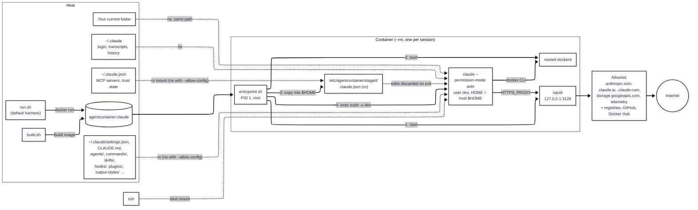

# Quickstart: Claude Code

Run [Claude Code](https://docs.claude.com/en/docs/claude-code) in a throwaway container
that sees your project and `~/.claude`, and nothing else from your home directory.
Claude Code is the default harness, so `run.sh` needs no `--harness` flag.

## 1. Build

```sh
git clone https://github.zhaw.ch/Security-Operations-Center/Agent-Container.git ~/Agent-Container
cd ~/Agent-Container
./build.sh claude              # agentcontainer:claude
```

You don't need Claude Code installed on the host; `harnesses/claude/install.sh`
installs it in the image with `npm install -g @anthropic-ai/claude-code`.

## 2. First run: log in

```sh
cd ~/path/to/some-project
~/Agent-Container/run.sh --allow-config
```

`run.sh` creates `~/.claude` and `~/.claude.json` if they're missing. Claude Code walks
you through onboarding and prints a login URL: open it in a browser on the host and
paste the code back into the terminal. `--allow-config` is needed this once so the
onboarding state in `~/.claude.json` is saved. The login token
(`~/.claude/.credentials.json`) is saved either way.

## 3. Every run after that

```sh
~/Agent-Container/run.sh               # claude --permission-mode auto in $PWD
~/Agent-Container/run.sh --continue    # `-` args are forwarded to claude
~/Agent-Container/run.sh --permission-mode manual   # override the auto default
~/Agent-Container/run.sh bash          # a plain shell instead of claude
```

Add an alias to start it from anywhere: `alias claudecli="$HOME/Agent-Container/run.sh"`.

## How a session works



- **Read-write:** your project and `~/.claude`, which Claude Code needs for its login,
  token refreshes, transcripts and history.
- **Read-only:** everything that could make the host's own `claude` run code later
  (settings with hooks, plugins, agents, commands, skills). Installing a plugin or
  changing a setting fails inside the session unless you pass `--allow-config`.
- **Copied in:** `~/.claude.json` is rewritten by Claude Code on every start, so it's
  mounted read-only elsewhere and copied into place. Trust prompts and other state in it
  reset every session.
- **Egress:** only through squid, to the domains in `harnesses/claude/allowed-domains.txt`
  plus the shared defaults.

## Common tweaks

| You want to | Do this |
|---|---|
| Change a setting, install a plugin or MCP server | Run once with `--allow-config`. |
| Keep a statusline script (or another file settings point at) read-only | `EXTRA_CONFIG_RO_PATHS+=(.claude/statusline.sh)` in `config/run.local.sh`. |
| Reach another domain | Add it to `config/allowed-domains.txt` and `./build.sh claude`, or `--allow-list FILE` for one session. |
| Update Claude Code | `./build.sh claude` (always `--no-cache`, pulls the latest release). |

See the [README](../README.md) for every flag, and
[harnesses/claude/harness.conf](../harnesses/claude/harness.conf) for exactly what gets
mounted.
