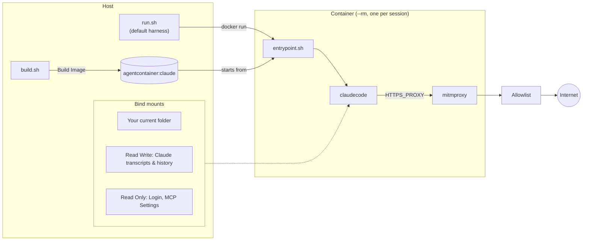

# Quickstart: Claude Code

Run [Claude Code](https://docs.claude.com/en/docs/claude-code) in a throwaway container
that sees your project and `~/.claude`, and nothing else from your home directory.
Claude Code is the default harness, so `run.sh` needs no `--harness` flag.

> [!NOTE]
> **Windows:** do the one-time host setup in [windows.md](windows.md) first (WSL2,
> Docker Desktop, Git), then use the PowerShell blocks below. Paths like `~/.claude`
> mean `%USERPROFILE%\.claude` there.

## 1. Build

Linux:

```sh
git clone https://github.zhaw.ch/Security-Operations-Center/Agent-Container.git ~/Agent-Container
cd ~/Agent-Container
./build.sh claude             # agentcontainer:claude
```

Windows (PowerShell):

```powershell
git clone https://github.zhaw.ch/Security-Operations-Center/Agent-Container.git "$HOME\Agent-Container"
cd "$HOME\Agent-Container"
.\build.ps1 claude            # agentcontainer:claude
```

You don't need Claude Code installed on the host; `harnesses/claude/install.sh`
installs it in the image with `npm install -g @anthropic-ai/claude-code`.

## 2. Add a shortcut

`run.sh` always works on the directory you start it from, so give it a short name you
can call from any project. Pick the block for your shell, run it once, and open a new
terminal (or run the last line) to pick it up.

bash (for zsh, use `~/.zshrc` in both lines):

```sh
echo 'alias claudecli="$HOME/Agent-Container/run.sh"' >> ~/.bashrc
source ~/.bashrc
```

fish:

```fish
alias --save claudecli "$HOME/Agent-Container/run.sh"
```

Windows PowerShell (adds a function to your `$PROFILE`):

```powershell
if (-not (Test-Path $PROFILE)) { New-Item -ItemType File -Force $PROFILE | Out-Null }
Add-Content $PROFILE "function claudecli { & `"$HOME\Agent-Container\run.ps1`" @args }"
. $PROFILE
```

If you cloned the repo somewhere other than `~/Agent-Container`, change the path. On
Windows, `. $PROFILE` fails if script execution is disabled; see
[Execution policy](windows.md#execution-policy). `claudecli --help` checks the shortcut
works: it prints the harness, mounts and network settings without starting anything.

## 3. First run: log in

Linux:

```sh
cd ~/path/to/some-project
claudecli --allow-config
```

Windows (PowerShell):

```powershell
cd C:\path\to\some-project
claudecli --allow-config
```

`run.sh` creates `~/.claude` and `~/.claude.json` if they're missing. Claude Code walks
you through onboarding and prints a login URL: open it in a browser on the host and
paste the code back into the terminal. `--allow-config` is needed this once so the
onboarding state in `~/.claude.json` is saved. The login token
(`~/.claude/.credentials.json`) is saved either way.

## 4. Every run after that

```sh
claudecli                            # claude --permission-mode auto in the current folder
claudecli --continue                 # `-` args are forwarded to claude
claudecli --permission-mode manual   # override the auto default
claudecli bash                       # a plain shell instead of claude
```

The same commands work in PowerShell through the `claudecli` function.

## How a session works



- **Read-write:** your project and `~/.claude`, which Claude Code needs for its login,
  token refreshes, transcripts and history. One exception: `~/.claude/shell-snapshots`
  is a container-local tmpfs - Claude Code sources those snapshots in every later Bash
  session *including native host runs*, so they're writable in the session but never
  reach the host.
- **Project-level settings:** `.claude/settings.json`, `.claude/settings.local.json`
  and `.mcp.json` sit in your (writable) project folder, where no mount can cover
  them - and the host's own `claude` trusts them on the next run in that folder. In the
  default (sandboxed) session, permission rules deny in-session edits to them. With
  `--no-bash-sandbox` they stay writable: don't have the session change the
  project's Claude Code config there, edit it on the host instead.
- **Read-only:** everything that could make the host's own `claude` run code later
  (settings with hooks, plugins, agents, commands, skills). Installing a plugin or
  changing a setting fails inside the session unless you pass `--allow-config`.
- **Copied in:** `~/.claude.json` is rewritten by Claude Code on every start, so it's
  mounted read-only elsewhere and copied into place. Trust prompts and other state in it
  reset every session.
- **Egress:** only through the proxy, to the domains in `harnesses/claude/allowed-domains.txt`
  plus the shared defaults.
- **Bash sandbox caveat, sysbox only:** under `--sysbox` the Bash sandbox falls back to
  nested mode (see the [README](../README.md#bash-sandbox)), where sandboxed shell
  commands can read `/proc/<pid>/environ` of Claude Code and its MCP servers - so
  `--env-file` variables, while stripped from the commands' own environment, are still
  reachable there. Don't run sysbox sessions with the Bash sandbox if the env file
  holds secrets that the project's prompts might want to exfiltrate.

## Common tweaks

| You want to | Do this |
|---|---|
| Change a setting, install a plugin or MCP server | Run once with `--allow-config`. |
| Keep a statusline script (or another file settings point at) read-only | `EXTRA_CONFIG_RO_PATHS+=(.claude/statusline.sh)` in `config/run.local.sh`. |
| Reach another domain | Add it to `config/allowed-domains.txt` and `./build.sh claude`, or `--allow-list FILE` for one session. |
| Update Claude Code | `./build.sh claude` (always `--no-cache`, pulls the latest release). |

See the [README](../README.md) for every flag, and
[harnesses/claude/harness.conf](../harnesses/claude/harness.conf) for exactly what gets
mounted.
