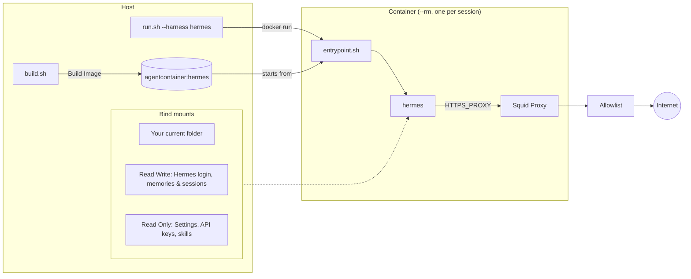

# Quickstart: Hermes Agent

Run [Hermes Agent](https://github.com/NousResearch/hermes-agent) in a throwaway
container that sees your project and `~/.hermes`, and nothing else from your home
directory.

> [!NOTE]
> **Windows:** do the one-time host setup in [windows.md](windows.md) first (WSL2,
> Docker Desktop, Git), then use the PowerShell blocks below. Paths like `~/.hermes`
> mean `%USERPROFILE%\.hermes` there.

## 1. Build

Linux:

```sh
git clone https://github.zhaw.ch/Security-Operations-Center/Agent-Container.git ~/Agent-Container
cd ~/Agent-Container
./build.sh hermes             # agentcontainer:hermes, about 6 GB
```

Windows (PowerShell):

```powershell
git clone https://github.zhaw.ch/Security-Operations-Center/Agent-Container.git "$HOME\Agent-Container"
cd "$HOME\Agent-Container"
.\build.ps1 hermes            # agentcontainer:hermes, about 6 GB
```

`harnesses/hermes/install.sh` runs the upstream installer into `/opt/hermes` inside the
image, since `~/.hermes` is mounted from the host at run time. The image is large
because Hermes brings its own Python, Node and UI builds.

## 2. Add a shortcut

`run.sh` always works on the directory you start it from, so give it a short name you
can call from any project. Pick the block for your shell, run it once, and open a new
terminal (or run the last line) to pick it up.

bash (for zsh, use `~/.zshrc` in both lines):

```sh
echo 'alias hermescli="$HOME/Agent-Container/run.sh --harness hermes"' >> ~/.bashrc
source ~/.bashrc
```

fish:

```fish
alias --save hermescli "$HOME/Agent-Container/run.sh --harness hermes"
```

Windows PowerShell (adds a function to your `$PROFILE`):

```powershell
if (-not (Test-Path $PROFILE)) { New-Item -ItemType File -Force $PROFILE | Out-Null }
Add-Content $PROFILE "function hermescli { & `"$HOME\Agent-Container\run.ps1`" --harness hermes @args }"
. $PROFILE
```

If you cloned the repo somewhere other than `~/Agent-Container`, change the path. On
Windows, `. $PROFILE` fails if script execution is disabled; see
[Execution policy](windows.md#execution-policy). `hermescli --help` checks the shortcut
works: it prints the harness, mounts and network settings without starting anything.

Instead of baking `--harness hermes` into the shortcut, you can make Hermes Agent the default
for plain `run.sh`/`run.ps1`: set `HARNESS=hermes` in `config/run.local.sh`, or
`$HARNESS = 'hermes'` in `config\run.local.ps1` on Windows.

## 3. First run: pick a model and log in

Linux:

```sh
cd ~/path/to/some-project
hermescli --allow-config
```

Windows (PowerShell):

```powershell
cd C:\path\to\some-project
hermescli --allow-config
```

Inside the session, run `hermes setup` (or `hermes model`) to choose a provider and log
in. `--allow-config` lets it save `~/.hermes/config.yaml` and `~/.hermes/.env`.

The first launch for each home also prepares a dependency environment in
`~/.hermes/installs` (about 670 MB), which takes a minute. It's kept on the host, so
later sessions skip it.

## 4. Every run after that

```sh
hermescli          # hermes in the current folder
hermescli bash     # a plain shell instead
```

The same commands work in PowerShell through the `hermescli` function.

You can run several `hermescli` sessions at once (Hermes runs one gateway daemon
per Hermes home, and each container gets its own private gateway inside the
otherwise-shared `~/.hermes`). Inside a `hermescli bash` session, `hermes` is the
same wrapper, so plain-shell sessions get a private gateway too.

## How a session works



- **Read-write:** your project and `~/.hermes`, which holds the login, memories,
  sessions, logs and the per-home dependency environment.
- **Read-only:** settings, API keys, identity (`SOUL.md`) and anything Hermes runs on
  its own: skills, hooks, plugins and scheduled jobs. Changing them needs
  `--allow-config`.
- **Baked in:** the Hermes code lives in `/opt/hermes`. Hermes refuses to run an install
  owned by another user, so `entrypoint.sh` re-chowns it when `dev` is remapped to your
  host UID (the `owned` key in `harness.conf`).
- **Egress:** only through squid, to the domains in
  `harnesses/hermes/allowed-domains.txt` plus the shared defaults.

## Common tweaks

| You want to | Do this |
|---|---|
| Use another hosted provider | Add its API domain to `config/allowed-domains.txt` and `./build.sh hermes`. |
| Use a self-hosted OpenAI-compatible server (llama.cpp, Ollama, vLLM) | Add it with its port, e.g. `llm.example.lan:8080`, rebuild, then set `provider: custom` and `base_url` in `~/.hermes/config.yaml` (with `--allow-config`). |
| Try a domain for one session | `--allow-list FILE` (replaces the list) or `--allow-internet`. |
| Update Hermes | `./build.sh hermes`. |

See the [README](../README.md) for every flag, and
[harnesses/hermes/harness.conf](../harnesses/hermes/harness.conf) for exactly what gets
mounted.
