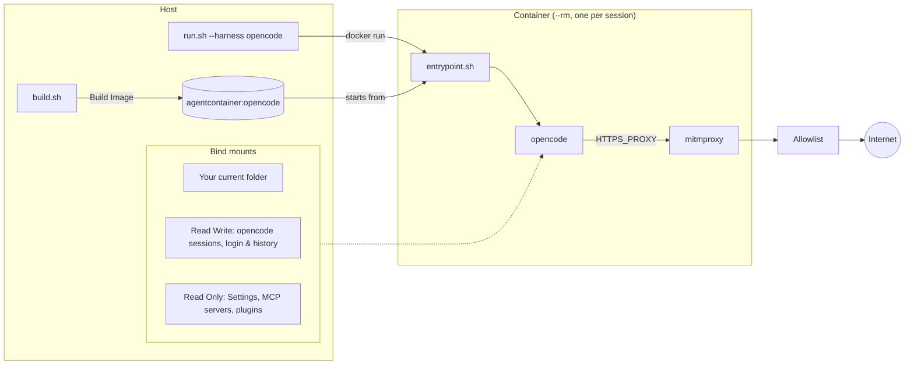

# Quickstart: opencode

Run [opencode](https://opencode.ai) in a throwaway container that sees your project and
opencode's own data and settings, and nothing else from your home directory.

> [!NOTE]
> **Windows:** do the one-time host setup in [windows.md](windows.md) first (WSL2,
> Docker Desktop, Git), then use the PowerShell blocks below. Paths like `~/.config/opencode`
> mean `%USERPROFILE%\.config\opencode` there.

## 1. Build

Linux:

```sh
git clone https://github.zhaw.ch/Security-Operations-Center/Agent-Container.git ~/Agent-Container
cd ~/Agent-Container
./build.sh opencode           # agentcontainer:opencode
```

Windows (PowerShell):

```powershell
git clone https://github.zhaw.ch/Security-Operations-Center/Agent-Container.git "$HOME\Agent-Container"
cd "$HOME\Agent-Container"
.\build.ps1 opencode          # agentcontainer:opencode
```

`harnesses/opencode/install.sh` installs OpenCode 2 with `npm install -g @opencode/cli`
and wraps it so self-update is off. A rebuild picks up the latest release instead.
V1 config (`~/.config/opencode/opencode.json`) keeps working as-is - OpenCode 2 reads
the same locations and auto-migrates the terminal settings; only custom V1 plugins and
server-API integrations need porting.

## 2. Add a shortcut

`run.sh` always works on the directory you start it from, so give it a short name you
can call from any project. Pick the block for your shell, run it once, and open a new
terminal (or run the last line) to pick it up.

bash (for zsh, use `~/.zshrc` in both lines):

```sh
echo 'alias opencodecli="$HOME/Agent-Container/run.sh --harness opencode"' >> ~/.bashrc
source ~/.bashrc
```

fish:

```fish
alias --save opencodecli "$HOME/Agent-Container/run.sh --harness opencode"
```

Windows PowerShell (adds a function to your `$PROFILE`):

```powershell
if (-not (Test-Path $PROFILE)) { New-Item -ItemType File -Force $PROFILE | Out-Null }
Add-Content $PROFILE "function opencodecli { & `"$HOME\Agent-Container\run.ps1`" --harness opencode @args }"
. $PROFILE
```

If you cloned the repo somewhere other than `~/Agent-Container`, change the path. On
Windows, `. $PROFILE` fails if script execution is disabled; see
[Execution policy](windows.md#execution-policy). `opencodecli --help` checks the shortcut
works: it prints the harness, mounts and network settings without starting anything.

Instead of baking `--harness opencode` into the shortcut, you can make opencode the default
for plain `run.sh`/`run.ps1`: set `HARNESS=opencode` in `config/run.local.sh`, or
`$HARNESS = 'opencode'` in `config\run.local.ps1` on Windows.

## 3. First run: connect a provider

Linux:

```sh
cd ~/path/to/some-project
opencodecli
```

Windows (PowerShell):

```powershell
cd C:\path\to\some-project
opencodecli
```

Inside opencode, run `/connect` (or `opencode auth login` from `opencodecli bash`) to
add a provider. Logins and API keys are stored with the session data in
`~/.local/share/opencode`, which is read-write, so they persist without
`--allow-config`.

## 4. Every run after that

```sh
opencodecli        # opencode in the current folder
opencodecli bash   # a plain shell instead
```

The same commands work in PowerShell through the `opencodecli` function.

## How a session works



- **Read-write:** your project, `~/.local/share/opencode` (sessions and credentials in
  one SQLite database, snapshots, logs) and `~/.local/state/opencode`.
- **Read-only:** `~/.config/opencode`. Settings, MCP servers, plugins, custom tools,
  agents, commands, skills and `AGENTS.md` can all make the host's opencode run
  something, so changing them needs `--allow-config`.
- **Not shared:** `~/.cache/opencode` holds the LSP servers and npm packages opencode
  downloads and executes. A writable mount would let a session plant code the host's
  opencode runs, so the container starts with an empty cache and fetches them again.
- **Egress:** only through the proxy, to the domains in
  `harnesses/opencode/allowed-domains.txt` plus the shared defaults.

## Common tweaks

| You want to | Do this |
|---|---|
| Change settings or add an MCP server | Run once with `--allow-config`. |
| Use another provider | Add its API domain to `config/allowed-domains.txt` and `./build.sh opencode`. |
| Try a domain for one session | `--allow-list FILE` (replaces the list) or `--allow-internet`. |
| Update opencode | `./build.sh opencode`. |

See the [README](../README.md) for every flag, and
[harnesses/opencode/harness.conf](../harnesses/opencode/harness.conf) for exactly what
gets mounted.
